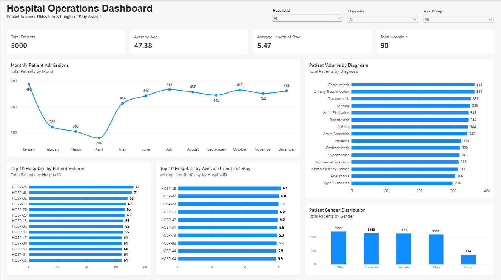

# Hospital Operations Analytics

### An End-to-End Healthcare Data Analytics Portfolio Project

## Project Overview

This project analyzes 5,000 patient records across 90 hospitals to explore patient demographics, hospital utilization, admission trends, diagnosis distribution, and length of stay.

The goal was to transform raw healthcare data into meaningful operational insights that could support hospital leadership in making informed decisions about staffing, resource allocation, and operational efficiency.

The project demonstrates the complete analytics workflow, from data quality assessment and cleaning through exploratory analysis, SQL querying, interactive dashboard development, and business recommendations.

## Business Questions

The analysis focused on answering the following questions:

1. What are the characteristics of the patient population?
2. Which diagnoses account for the highest patient volumes?
3. How does patient admission volume change throughout the year?
4. How does average length of stay vary across hospitals?
5. Which hospitals experience the highest patient volumes?
6. What data-quality limitations could affect reporting accuracy?

## Tools & Technologies

| Tool | Application |
|---|---|
| Microsoft Excel | Data exploration, formulas, PivotTables, and descriptive statistics |
| Power Query | Data cleaning, transformation, and validation |
| SQL (SQLite) | Data querying, aggregation, and validation |
| DBeaver | Database management and SQL development |
| Power BI | Interactive dashboard development and data visualization |
| DAX | Calculated measures and dynamic reporting |

## Dataset

The dataset contains 5,000 patient records representing 90 hospitals.

Original fields include:

- PatientID
- Age
- Gender
- Diagnosis
- AdmissionDate
- DischargeDate
- HospitalID

Additional fields were created during data preparation, including age groups, date-validation status, and length of stay.

**Data Source:** This project uses a synthetic healthcare dataset containing 5,000 fictional patient records across 90 hospitals. The data was created for educational and portfolio purposes and does not represent actual patients or hospital performance.

**Privacy:** No real patient information or protected health information (PHI) is included in this dataset.

## Analytical Process

### 1. Data Quality Assessment

Evaluated the dataset for missing values, duplicate patient identifiers, inconsistent categories, and invalid date sequences.

Key findings included:

- 350 missing age values (7%)
- 350 missing gender values (7%)
- 350 missing diagnosis values (7%)
- 150 invalid admission/discharge date sequences (3%)
- No duplicate PatientIDs

### 2. Data Cleaning & Transformation

Used Power Query to standardize data types and diagnosis formatting, preserve missing age values, create explicit missing categories for gender and diagnosis, and flag invalid date sequences.

Length of stay was calculated only for records with valid admission and discharge dates.

The original dataset was preserved separately from the cleaned data.

### 3. Exploratory Data Analysis

Used Excel formulas, PivotTables, and visualizations to investigate patient demographics, diagnosis frequency, hospital volume, admission trends, and length of stay.

### 4. SQL Analysis

Imported the cleaned dataset into SQLite and developed SQL queries to answer operational business questions.

The SQL workflow also identified and corrected a CSV import issue in which blank numeric fields were interpreted as empty strings rather than SQL NULL values.

This step reinforced the importance of validating calculations across tools.

### 5. Power BI Dashboard

Created an interactive Power BI dashboard featuring:

- Total Patients
- Average Patient Age
- Average Length of Stay
- Total Hospitals
- Monthly Patient Admissions
- Patient Volume by Diagnosis
- Highest-Volume Hospitals
- Hospitals with the Highest Average Length of Stay
- Patient Gender Distribution

Interactive slicers allow users to filter by hospital, diagnosis, and age group.

## Dashboard Preview



## Key Findings

| Metric | Result |
|---|---|
| Total Patients | 5,000 |
| Total Hospitals | 90 |
| Average Patient Age | 47.4 years |
| Average Length of Stay | 5.5 days |
| Highest Monthly Admissions | January - 488 |
| Lowest Monthly Admissions | April - 280 |
| Highest-Volume Hospital | HOSP-25 - 72 patients |
| Hospital with Highest Average LOS | HOSP-85 - approximately 6.1 days |
| Most Frequent Diagnoses | Urinary Tract Infection and Cholelithiasis - 363 each |

### Operational Insights

**Admission trends:** Admissions declined from January through April before increasing in May and remaining relatively stable throughout the rest of the year.

**Hospital utilization:** Patient volumes varied across hospitals, while average length of stay showed relatively modest differences.

**Diagnosis distribution:** No single diagnosis dominated patient volume, indicating a diverse mix of recorded conditions.

**Data quality:** Missing demographic and diagnosis information, along with invalid date sequences, created limitations for certain analyses.

## Business Recommendations

Based on the findings, the following recommendations were developed:

1. Investigate differences in average length of stay while accounting for patient severity and hospital characteristics.
2. Analyze multiple years of admission data before making seasonal staffing or capacity decisions.
3. Monitor diagnosis trends alongside clinical resource utilization.
4. Compare hospital patient volume with staffing levels and available capacity.
5. Strengthen data-entry validation and standardize data definitions to improve reporting reliability.

The full recommendations are available in the Business Insights & Recommendations PDF in the `reports` folder.

## Limitations

This analysis is descriptive and does not establish causation.

The dataset does not include information about patient acuity, treatment costs, hospital capacity, readmissions, or clinical outcomes.

Missing values and invalid dates may affect the interpretation of certain measures.

Additional data would be required before drawing conclusions about hospital performance or operational efficiency.

## Repository Structure

```text
Hospital_Operations_Analytics/
│
├── data/
│   ├── hospital_patients_clean.csv
│   └── Project1_Portfolio_Polished.xlsx
│
├── sql/
│   └── hospital_analysis.sql
│
├── dashboard/
│   ├── hospital_dashboard.pbix
│   └── hospital_dashboard.png
│
├── reports/
│   └── Hospital_Operations_Business_Insights_and_Recommendations.pdf
│
└── README.md
```

## Skills Demonstrated

- Data quality assessment and validation
- Data cleaning and transformation
- Exploratory data analysis
- SQL querying and aggregation
- Cross-tool data validation
- DAX measure development
- Interactive dashboard design
- Healthcare operations analysis
- Data storytelling
- Business insights and recommendations

## Project Takeaway

This project strengthened my ability to approach data analysis as an end-to-end business process rather than a series of isolated technical tasks.

A particularly valuable learning experience was identifying discrepancies between Excel and SQL calculations, investigating the underlying cause, and correcting how missing values were represented.

The project also reinforced the importance of communicating findings responsibly, recognizing data limitations, and connecting analytical results to practical business decisions.
The analysis focused on answering the following questions:

1. What are the characteristics of the patient population?
2. Which diagnoses account for the highest patient volumes?
3. How does patient admission volume change throughout the year?
4. How does average length of stay vary across hospitals?
5. Which hospitals experience the highest patient volumes?
6. What data-quality limitations could affect reporting accuracy?
